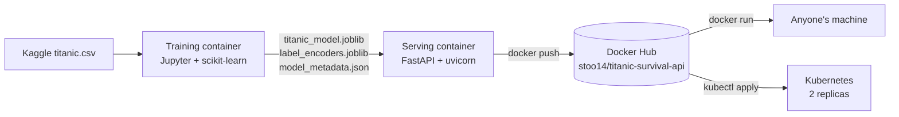
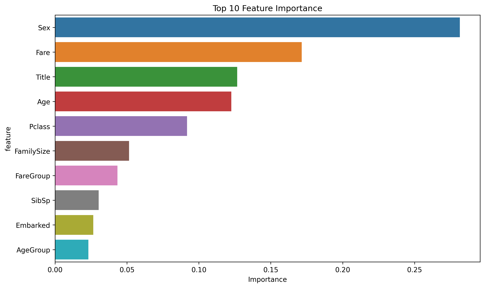

# Titanic Survival Prediction API

[](https://github.com/YoStoo/titanic-survival-api/actions/workflows/ci.yml)
[](https://hub.docker.com/r/stoo14/titanic-survival-api)

A machine learning model that predicts whether a Titanic passenger would have survived, served as a web API with FastAPI and packaged as a Docker image that anyone can run with one command.

```bash
docker run -p 8000:8000 stoo14/titanic-survival-api
```

Then open http://localhost:8000/docs to try it in the browser.

Built during the TripleTen AI/ML bootcamp, Sprint 11 (Docker and Containerization). The project was reviewed and accepted on September 30, 2026.

## What it does

You send the API a passenger's details: ticket class, sex, age, family aboard, fare, and port. It sends back:

- `survived`: 0 or 1
- `survival_probability`: how likely the model thinks survival was, from 0 to 1
- `prediction_confidence`: High, Medium, or Low
- `passenger_profile`: a plain-English summary of the passenger

The model is a Random Forest (100 decision trees that each vote) trained on the Kaggle Titanic passenger list. According to `models/model_metadata.json`, it scored **81.6% accuracy** on passengers held back from training.

## How it works



1. **Training.** A Jupyter container cleaned the data, filled missing ages and fares with the median, and built five new features: `FamilySize`, `IsAlone`, `Title` (Mr, Mrs, Miss…), `AgeGroup`, and `FareGroup`. It trained the Random Forest and saved the model, the text-to-number encoders, and the metadata with `joblib`.
2. **Serving.** `app.py` loads those files once at startup. Each request rebuilds the same five features from the raw input, encodes them the same way as training, and asks the model for a probability.
3. **Packaging.** The `Dockerfile` copies the code and model into a `python:3.11-slim` image. The image was pushed to Docker Hub as `v1.0` and `latest`.

### What the model learned



## API

| Method | Path | What it does |
| --- | --- | --- |
| `GET` | `/` | Health check. Says whether the model loaded. |
| `POST` | `/predict` | Predict one passenger. |
| `POST` | `/predict-batch` | Predict a list of passengers. |
| `GET` | `/model-info` | Model type, training date, accuracy, and features. |
| `GET` | `/docs` | Interactive Swagger docs, generated by FastAPI. |

### Example: third-class man, traveling alone

```bash
curl -X POST http://localhost:8000/predict \
  -H "Content-Type: application/json" \
  -d '{"Pclass": 3, "Sex": "male", "Age": 25.0, "SibSp": 0, "Parch": 0, "Fare": 8.05, "Embarked": "S"}'
```

```json
{
  "survived": 0,
  "survival_probability": 0.07595686367815455,
  "prediction_confidence": "High",
  "passenger_profile": {
    "class": "Class 3",
    "gender": "male",
    "age_group": "Adult",
    "family_size": 1,
    "traveling_alone": true,
    "fare_level": "Low",
    "embarkation_port": "Southampton"
  }
}
```

### Example: first-class woman

```bash
curl -X POST http://localhost:8000/predict \
  -H "Content-Type: application/json" \
  -d '{"Pclass": 1, "Sex": "female", "Age": 30.0, "SibSp": 0, "Parch": 0, "Fare": 50.0, "Embarked": "S"}'
```

```json
{
  "survived": 1,
  "survival_probability": 0.9152319739084446,
  "prediction_confidence": "High",
  "passenger_profile": {
    "class": "Class 1",
    "gender": "female",
    "age_group": "Adult",
    "family_size": 1,
    "traveling_alone": true,
    "fare_level": "High",
    "embarkation_port": "Southampton"
  }
}
```

Same model, very different answers: about an 8% chance for the man versus about 92% for the woman. That matches the "women and children first" pattern in the real history.

### Health check

```bash
curl http://localhost:8000/
```

```json
{"message": "Titanic Survival Prediction API", "status": "healthy", "model_loaded": true, "accuracy": 0.8156424581005587}
```

## Run it

**From Docker Hub (no code needed):**

```bash
docker pull stoo14/titanic-survival-api:latest
docker run -p 8000:8000 stoo14/titanic-survival-api:latest
```

**Build it yourself:**

```bash
git clone https://github.com/YoStoo/titanic-survival-api.git
cd titanic-survival-api
docker build -t titanic-survival-api .
docker run -p 8000:8000 titanic-survival-api
```

**Without Docker (Python 3.11):**

```bash
pip install -r requirements-dev.txt
uvicorn app:app --port 8000
python -m pytest -v
```

## Kubernetes

The `k8s/` folder runs the same image on a Kubernetes cluster, such as minikube or Docker Desktop's built-in one.

- `deployment.yaml` runs **2 replicas** (two copies of the API), so one can crash or restart while the other keeps answering. Kubernetes checks `GET /` to decide when a copy is ready for traffic (readiness) and when to restart it (liveness).
- `service.yaml` gives both copies one address and spreads requests between them.

```bash
kubectl apply -f k8s/
kubectl get pods -l app=titanic-survival-api
minikube service titanic-survival-api --url   # on minikube
# or: kubectl port-forward service/titanic-survival-api 8000:8000
```

Scale up or down with `kubectl scale deployment titanic-survival-api --replicas=4`. Remove everything with `kubectl delete -f k8s/`.

## Tests and CI

GitHub Actions runs on every push:

- **Unit tests.** `tests/test_api.py` uses FastAPI's `TestClient` to call every endpoint and check the answers: valid probabilities, batch counts, bad input rejected, and a first-class woman scoring higher than a third-class man.
- **Docker build.** Builds the image, starts it, waits for Docker's health check to say `healthy`, and calls the API with `curl`.
- **Published image.** Pulls `stoo14/titanic-survival-api` from Docker Hub and makes a real prediction, to prove the public image still works.
- **Kubernetes.** Checks the manifests with `kubeconform`.

Nothing is pushed to Docker Hub from CI, and no secrets are used.

## Bugs found and fixed

- **NumPy 2 broke the pinned libraries.** The course's `requirements.txt` pinned `pandas==2.0.3` and `scikit-learn==1.3.0` but not NumPy, so pip pulls in NumPy 2, which those versions were not built for. The app crashes on import with `ValueError: numpy.dtype size changed, may indicate binary incompatibility`. Pinning `numpy==1.26.4` fixed it, and that pin is in the published image.
- **The health check could never pass.** The `HEALTHCHECK` used `curl`, but `python:3.11-slim` does not include `curl`. The API worked fine, yet Docker would have reported the container as unhealthy forever. The `Dockerfile` here uses Python's built-in `urllib` instead. (The published `v1.0` image still has the original check.)

## Known limitations

- The API does not take a passenger's name, so `Title` is guessed from sex and age (male = Mr, adult female = Mrs, younger female = Miss). Training used the real title from the name, so rare titles like Dr or Master are never sent to the model.
- Unknown values (like a port other than S, C, or Q) fall back to encoding `0` instead of returning an error.
- Accuracy is one number from one test split. There is no cross-validation or calibration check.

## Tech stack

Python 3.11 · scikit-learn 1.3 (Random Forest) · pandas · FastAPI · Pydantic · uvicorn · joblib · Docker · Docker Hub · Kubernetes · GitHub Actions · pytest

## Project structure

```
titanic-survival-api/
├── app.py                  # FastAPI app: loads the model, preprocessing, endpoints
├── requirements.txt        # Pinned serving dependencies
├── requirements-dev.txt    # + pytest and httpx for tests
├── Dockerfile              # Serving image (python:3.11-slim, port 8000)
├── models/
│   ├── titanic_model.joblib     # Trained Random Forest
│   ├── label_encoders.joblib    # Text-to-number encoders from training
│   ├── model_metadata.json      # Accuracy, features, parameters
│   ├── sample_input.json        # One example passenger
│   ├── feature_importance.png   # Training plots
│   └── confusion_matrix.png
├── k8s/
│   ├── deployment.yaml     # 2 replicas, readiness and liveness probes
│   └── service.yaml        # NodePort service on port 8000
├── tests/
│   └── test_api.py         # TestClient smoke tests
└── .github/workflows/ci.yml
```

## Where this code came from

The original project lived on a local machine. This repo was rebuilt in November 2026 from the published Docker Hub image:

- `app.py`, `requirements.txt`, and everything in `models/` were copied unchanged from the image's `/app` folder.
- The `Dockerfile` was rebuilt line for line from the image's build history. The only change since is the health check fix above.
- The training script and the Jupyter training container were not part of the serving image, so they are not in this repo. The trained model and its plots are.
- The tests, Kubernetes manifests, CI workflow, and this README were added afterward.

The project followed the TripleTen Sprint 11 brief, which provided starter code for the training script and the API.
